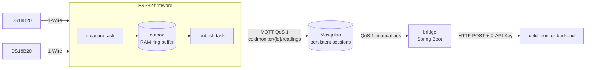
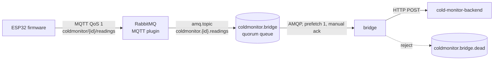

# cold-monitor-edge

[English](#english) · [Português (Brasil)](#português-brasil)

---

## English

The device side of **cold-monitor**, a cold-chain temperature monitoring system: ESP32 firmware that reads DS18B20
probes in fridges and cold rooms and publishes the readings over **MQTT**, and a small **bridge** that takes them from
the broker and posts them to the [cold-monitor backend](https://github.com/carloslpv/cold-monitor-backend).

The goal is that no reading is lost when the network is not perfect: Wi-Fi drops, the broker restarts, the backend is
being deployed. Each hop keeps the data until the next one confirms it.



The broker can also be **RabbitMQ**, with the same firmware: its MQTT plugin takes the devices' messages, and the
bridge consumes a durable queue over **AMQP**, with a dead-letter queue for what it cannot forward (see
[With RabbitMQ](#with-rabbitmq)).

The architecture diagram of the whole system, screenshots and the dashboard are in
[cold-monitor-infra](https://github.com/carloslpv/cold-monitor-infra).

### Status

The firmware builds in CI with ESP-IDF 5.4. Its delivery logic and its 1-Wire and DS18B20 drivers are covered by
host tests, and on every push the real firmware runs in the QEMU emulator against the repository's Mosquitto
config and against the RabbitMQ one, with the connection cut for 30 seconds in the middle (see [Tests](#tests)).
The bridge is covered by integration tests against an embedded MQTT broker, a RabbitMQ container and a fake backend,
and was run end to end with
[`tools/fake_device.py`](tools/fake_device.py). A bench test with real probes is the next step.

### Repository layout

| Path | What it is |
| --- | --- |
| [`firmware/`](firmware) | ESP-IDF project in C for the ESP32 |
| [`firmware/components/telemetry/`](firmware/components/telemetry) | Hardware-free logic (outbox, payload, backoff, config parsing), unit tested on the PC |
| [`firmware/components/onewire/`](firmware/components/onewire) | 1-Wire bus: ROM search, CRC-8 and the bit timing on a GPIO |
| [`firmware/components/ds18b20/`](firmware/components/ds18b20) | DS18B20 driver: conversion, resolution, scratchpad checks |
| [`firmware/components/onewire_sim/`](firmware/components/onewire_sim) | Simulated 1-Wire bus with DS18B20 probes, used by the driver tests and the emulator build |
| [`firmware/test/qemu/`](firmware/test/qemu) | End-to-end test of the firmware running in QEMU |
| [`bridge/`](bridge) | Java 25 / Spring Boot 4.1 service from MQTT or AMQP to the backend API |
| [`mosquitto/`](mosquitto) | Broker configuration with per-device ACL |
| [`rabbitmq/`](rabbitmq), [`compose.rabbitmq.yaml`](compose.rabbitmq.yaml) | The same setup with RabbitMQ: config, plugins, and a script that creates users with the same per-device rights |
| [`tools/fake_device.py`](tools/fake_device.py) | Publishes like the firmware, for trying everything without hardware |

### MQTT topics

| Topic | Direction | QoS | Retained | Payload |
| --- | --- | --- | --- | --- |
| `coldmonitor/<id>/readings` | device → bridge | 1 | no | `{"device":"cm-a1b2c3","boot":3735928559,"seq":42,"probe":"28ff4a1c0b160351","t":4.25,"ts":1761868800}` |
| `coldmonitor/<id>/status` | device → bridge | 1 | yes | `online`, or `offline` published by the broker as the device's last will |
| `coldmonitor/<id>/config` | operator → device | 1 | yes | `{"interval_s":30}` |

`t` is in °C with two decimals, `ts` is Unix time in seconds (left out while the device clock is not set), `boot` is
a random number drawn at every boot and `seq` counts readings since boot.

### How delivery works

**Firmware.** A measuring task reads all probes on a fixed period and stores the readings in an outbox, a ring
buffer in RAM. It never touches the network, so a dead access point does not delay measurements. A publishing task
sends the outbox while connected, with QoS 1 and at most 8 messages in flight. A reading leaves the outbox only when
the broker's PUBACK arrives; when the connection drops, in-flight readings go back to the queue and are sent again.
With the defaults the outbox holds 720 readings, 12 hours of one probe at one reading per minute; when full, the
oldest reading is dropped and counted, because stopping measurements would be worse.

Readings taken before NTP sets the clock are dated later from the uptime, so a reading that waited in the outbox
still carries the time it was taken. Wi-Fi reconnects with exponential backoff and jitter, so a room full of devices
does not hammer the access point at the same instant after an outage.

**Broker.** Mosquitto keeps the bridge's persistent session on disk, with up to 100,000 queued messages. Each device
logs in with its device id as user name, and the ACL lets it publish only under its own topics.

**Bridge.** It subscribes with a persistent session (`cleanSession = false`) and acknowledges each message only
after the backend answered `201`. While the backend is unreachable, or answers 5xx, 429, 401 or 403, the bridge
retries the same reading with growing delays and takes no new message, so the backlog stays in the broker and
arrives in order later. A reading the backend rejects for good (400, 404) is logged, counted and dropped, so one bad
message cannot block the queue. If the bridge stops in the middle of a retry, the message stays unacknowledged and
the broker delivers it again after the restart.

At-least-once delivery means duplicates are possible: the firmware resends what was not acknowledged. The bridge
remembers the last 10,000 `device/boot/seq` keys it forwarded and drops repeats.

### With RabbitMQ



The firmware does not change: it still speaks MQTT, now to RabbitMQ's MQTT plugin, which publishes every message
to the `amq.topic` exchange with the topic's slashes turned into dots. With `BRIDGE_SOURCE=amqp` the bridge declares
a durable quorum queue bound to `coldmonitor.*.readings` and `coldmonitor.*.status` and consumes it with manual
acknowledgements and a prefetch of one, so the guarantees are those of the MQTT path: a message is acknowledged
only after the backend took it, and while the backend is down the backlog waits in the queue, in order. What the
MQTT path can only log and drop (an unregistered probe, a reading the backend rejects, a malformed message) is
rejected instead and lands in the `coldmonitor.bridge.dead` queue, where it waits to be looked at (management UI,
"Get messages") instead of being lost.

RabbitMQ closes a channel whose message stays unacknowledged longer than its consumer timeout (30 minutes by
default), which happens when the backend is down that long; the message goes back to the queue and the bridge opens
a new channel and carries on.

The rights match the Mosquitto ACL: [`rabbitmq/users.sh`](rabbitmq/users.sh) gives each device topic permissions
on `amq.topic` limited to `coldmonitor.<its user name>.(readings|status)` for writing and its own `config` for
reading. A device that publishes under another device's id is disconnected, and a subscription to another device's
config is refused. The bridge can only touch its own queues and exchange.

```bash
cp .env.example .env    # RABBITMQ_ADMIN_PASSWORD, AMQP_BRIDGE_PASSWORD, the backend URL and key, the probes
docker compose -f compose.rabbitmq.yaml up -d rabbitmq
./rabbitmq/users.sh bridge              # asks for the password, the same as AMQP_BRIDGE_PASSWORD
./rabbitmq/users.sh device cm-a1b2c3    # one user per device, named after its id
docker compose -f compose.rabbitmq.yaml up -d
```

The management UI is on port 15672 (user `admin`).

**Which one.** Mosquitto is a single small process and is enough for one site. RabbitMQ fits when the readings
should also feed other consumers (an alarm service, a data export) without touching the bridge, each with its own
queue bound to `amq.topic`, or when the operations team already runs it.

### Design decisions

- **A bridge instead of MQTT inside the backend.** The backend keeps a single way in (REST with an API key) and
  knows nothing about protocols. Another transport (LoRaWAN, a Modbus gateway) becomes another small bridge.
- **Probe id, not device id, maps to equipment.** One ESP32 in a cold room can carry probes for two freezers, and a
  replaced probe is re-registered in one line (`BRIDGE_PROBES`) without reflashing.
- **Own outbox in the firmware** rather than relying on the MQTT client's internal queue: it is bounded, its
  overflow policy is explicit, and it is plain C that runs in unit tests on the PC.
- **Own 1-Wire and DS18B20 drivers** instead of a component from the registry. The protocol part (ROM search,
  CRC, decoding) is plain C on top of three bit operations (reset, write bit, read bit), so the same code runs on the
  ESP32 and, in tests, against a simulated bus that answers bit by bit like real probes, including several probes
  talking at once. On the ESP32 the bits are timed with interrupts off for at most about 70 µs per slot, on the core
  that does not run Wi-Fi. The driver checks what cheap probes and long cables get wrong: a bad CRC, a line held low
  (nine zero bytes pass the CRC), and the 85 °C value a probe reports after losing power. The build also needs
  nothing from the internet besides ESP-IDF itself.
- **Integers in the payload.** Temperatures travel as hundredths of a degree inside the firmware and are printed with
  integer formatting, so `4.25` is never sent as `4.2499999`.
- **Paho with manual acks** instead of Spring Integration: the acknowledgement point is the whole point of the
  bridge, and here it is one explicit line.

### Hardware

ESP32 DevKit, one or more DS18B20 (waterproof version for fridges), a 4.7 kΩ resistor between data and 3.3 V. Data
goes to GPIO 4 by default. Several probes share the same wire.

### Running

**Broker and bridge (Docker).**

```bash
cp .env.example .env    # fill in the passwords, the backend URL and key, and the probes
docker run --rm -it -v ./mosquitto:/mosquitto/config eclipse-mosquitto:2 \
  mosquitto_passwd -c /mosquitto/config/passwd bridge
docker run --rm -it -v ./mosquitto:/mosquitto/config eclipse-mosquitto:2 \
  mosquitto_passwd /mosquitto/config/passwd cm-a1b2c3      # one user per device, named after its id
docker compose up -d
```

The bridge serves health and Prometheus metrics on port 8081 (`/actuator/health`, `/actuator/prometheus`):
readings by outcome (`forwarded`, `duplicate`, `unknown_probe`, `rejected`, `invalid`), retries and devices online.

**Firmware.** Requires [ESP-IDF 5.4](https://docs.espressif.com/projects/esp-idf/en/v5.4/esp32/get-started/).

```bash
cd firmware
idf.py set-target esp32
idf.py menuconfig       # "cold-monitor edge": Wi-Fi, broker URI, password, GPIO, interval
idf.py build flash monitor
```

The serial log shows the device id (`cm-` and the end of the MAC address) and each probe's ROM code; register both
in the broker and in `BRIDGE_PROBES`. Credentials live in `sdkconfig`, which git ignores.

**Without hardware.**

```bash
pip install paho-mqtt
python tools/fake_device.py --device cm-test --password <password> --probe 28ff4a1c0b160351
```

Or run the real firmware in the emulator, with two simulated probes (a fridge around 5 °C, a freezer around
-25 °C) and emulated Ethernet instead of Wi-Fi: build it with `sdkconfig.qemu` on top of the defaults and start
`idf.py qemu`. It connects to the broker at 10.0.2.2:1883 (the host, seen from inside QEMU) as `cm-qemu`, and expects
an NTP server at the same address; the end-to-end test below provides both.

```bash
cd firmware
idf.py -B build-qemu -D SDKCONFIG=build-qemu/sdkconfig -D SDKCONFIG_DEFAULTS="sdkconfig.defaults;sdkconfig.qemu" build
idf.py -B build-qemu qemu
```

Change the reading interval of a device at run time:

```bash
mosquitto_pub -u admin -P <password> -t coldmonitor/cm-a1b2c3/config -r -q 1 -m '{"interval_s":30}'
```

### Tests

```bash
# firmware logic on the PC, with AddressSanitizer and UBSan
cmake -S firmware/components/telemetry/test -B build/telemetry-test
cmake --build build/telemetry-test && ./build/telemetry-test/telemetry_test

# 1-Wire and DS18B20 drivers against the simulated bus
cmake -S firmware/components/onewire/test -B build/onewire-test
cmake --build build/onewire-test && ./build/onewire-test/onewire_test

# bridge: unit and integration tests (embedded MQTT broker, RabbitMQ in a container through Testcontainers,
# fake backend over real HTTP); needs Docker
cd bridge && ./mvnw verify
```

**End to end in QEMU.** [`firmware/test/qemu/e2e.py`](firmware/test/qemu/e2e.py) (standard library only) starts
the emulator and plays the rest of the world: an SNTP server, a TCP proxy in front of a real Mosquitto running this
repository's config and ACL, and an MQTT subscriber. It checks that readings arrive with sane values and timestamps,
cuts the connection for 30 seconds, checks that the broker publishes the device's last will (`offline`), restores
the connection and checks that every reading taken meanwhile is delivered with the time it was taken, with no gap
in `seq`:

```
1. device boots, sets its clock and publishes
2. connection cut for 30 s
  status: offline
3. connection restored
  status: online
4. ok: seq 1..24 with no gaps, 12 readings taken during the outage delivered afterwards with their own timestamps, 0 duplicate(s)
```

The `firmware-e2e` job in [`.github/workflows/ci.yml`](.github/workflows/ci.yml) runs it against Mosquitto and
against RabbitMQ, each with this repository's config and users, and shows how to run it with Docker.

GitHub Actions builds the firmware with Espressif's ESP-IDF image, runs the test suites, runs the end-to-end test
and builds the bridge image.

### Next steps

- Keep the outbox in flash (NVS or LittleFS) so readings survive a power cut, not only a network outage.
- TLS (`mqtts://`) with a certificate per device, provisioned at the bench.
- OTA firmware updates over HTTPS, triggered through the config topic.
- Idempotency key in the backend, so duplicates are dropped there too and the bridge can run with more than one
  instance.

---

## Português (Brasil)

O lado do dispositivo do **cold-monitor**, um sistema de monitoramento de temperatura da cadeia fria: um firmware para
ESP32 que lê sondas DS18B20 em geladeiras e câmaras frias e publica as leituras por **MQTT**, e uma **ponte** pequena
que pega as leituras no broker e envia para o [backend do cold-monitor](https://github.com/carloslpv/cold-monitor-backend).

O objetivo é não perder leitura quando a rede não é perfeita: o Wi-Fi cai, o broker reinicia, o backend está em
deploy. Cada etapa guarda o dado até a próxima confirmar que recebeu.

O broker também pode ser o **RabbitMQ**, com o mesmo firmware: o plugin MQTT dele recebe as mensagens dos
dispositivos, e a ponte consome uma fila durável por **AMQP**, com uma fila de erro (dead-letter) para o que ela não
consegue encaminhar (veja [Com RabbitMQ](#com-rabbitmq)).

Os diagramas acima valem para as duas línguas. A visão geral do sistema, os screenshots e o painel estão no
[cold-monitor-infra](https://github.com/carloslpv/cold-monitor-infra).

### Situação

O firmware compila no CI com ESP-IDF 5.4. A lógica de entrega e os drivers de 1-Wire e DS18B20 são cobertos por
testes que rodam no PC, e a cada push o firmware de verdade roda no emulador QEMU contra a configuração de Mosquitto
do repositório e contra a de RabbitMQ, com a conexão cortada por 30 segundos no meio (veja [Testes](#testes)). A
ponte tem testes de integração com um broker MQTT embutido, um RabbitMQ em contêiner e um backend falso, e foi rodada
de ponta a ponta com o
[`tools/fake_device.py`](tools/fake_device.py). O próximo passo é o teste de bancada com sondas reais.

### Estrutura

| Caminho | O que é |
| --- | --- |
| [`firmware/`](firmware) | Projeto ESP-IDF em C para o ESP32 |
| [`firmware/components/telemetry/`](firmware/components/telemetry) | Lógica sem hardware (outbox, payload, backoff, leitura de config), com testes no PC |
| [`firmware/components/onewire/`](firmware/components/onewire) | Barramento 1-Wire: busca de ROM, CRC-8 e a temporização dos bits num GPIO |
| [`firmware/components/ds18b20/`](firmware/components/ds18b20) | Driver do DS18B20: conversão, resolução, conferência do scratchpad |
| [`firmware/components/onewire_sim/`](firmware/components/onewire_sim) | Barramento 1-Wire simulado com sondas DS18B20, usado nos testes dos drivers e no build do emulador |
| [`firmware/test/qemu/`](firmware/test/qemu) | Teste de ponta a ponta do firmware rodando no QEMU |
| [`bridge/`](bridge) | Serviço Java 25 / Spring Boot 4.1 do MQTT ou do AMQP para a API do backend |
| [`mosquitto/`](mosquitto) | Configuração do broker com ACL por dispositivo |
| [`rabbitmq/`](rabbitmq), [`compose.rabbitmq.yaml`](compose.rabbitmq.yaml) | A mesma montagem com RabbitMQ: config, plugins e um script que cria os usuários com os mesmos direitos por dispositivo |
| [`tools/fake_device.py`](tools/fake_device.py) | Publica como o firmware, para testar tudo sem hardware |

### Tópicos MQTT

| Tópico | Sentido | QoS | Retido | Conteúdo |
| --- | --- | --- | --- | --- |
| `coldmonitor/<id>/readings` | dispositivo → ponte | 1 | não | `{"device":"cm-a1b2c3","boot":3735928559,"seq":42,"probe":"28ff4a1c0b160351","t":4.25,"ts":1761868800}` |
| `coldmonitor/<id>/status` | dispositivo → ponte | 1 | sim | `online`, ou `offline` publicado pelo broker como last will do dispositivo |
| `coldmonitor/<id>/config` | operador → dispositivo | 1 | sim | `{"interval_s":30}` |

`t` é em °C com duas casas, `ts` é o horário Unix em segundos (ausente enquanto o relógio do dispositivo não foi
acertado), `boot` é um número aleatório sorteado a cada boot e `seq` conta as leituras desde o boot.

### Como a entrega funciona

**Firmware.** Uma tarefa de medição lê todas as sondas num período fixo e guarda as leituras numa outbox, um buffer
circular na RAM. Ela nunca usa a rede, então um access point fora do ar não atrasa as medições. Uma tarefa de
publicação envia a outbox enquanto há conexão, com QoS 1 e no máximo 8 mensagens em voo. Uma leitura só sai da outbox
quando chega o PUBACK do broker; se a conexão cai, as leituras em voo voltam para a fila e são enviadas de novo. No
padrão, a outbox guarda 720 leituras, 12 horas de uma sonda com uma leitura por minuto; cheia, ela descarta a leitura
mais antiga e conta o descarte, porque parar de medir seria pior.

Leituras feitas antes de o NTP acertar o relógio recebem o horário depois, calculado pelo uptime, então uma leitura
que esperou na outbox continua com o horário em que foi feita. O Wi-Fi reconecta com backoff exponencial e jitter,
para que uma sala cheia de dispositivos não bata no access point no mesmo instante depois de uma queda.

**Broker.** O Mosquitto guarda em disco a sessão persistente da ponte, com até 100 mil mensagens na fila. Cada
dispositivo entra com o próprio id como usuário, e a ACL só deixa ele publicar nos próprios tópicos.

**Ponte.** Ela assina com sessão persistente (`cleanSession = false`) e só confirma cada mensagem depois que o
backend respondeu `201`. Enquanto o backend está fora do ar, ou responde 5xx, 429, 401 ou 403, a ponte tenta de novo
a mesma leitura com esperas crescentes e não pega mensagem nova, então o acúmulo fica no broker e chega em ordem
depois. Uma leitura que o backend recusa de vez (400, 404) é registrada no log, contada e descartada, para que uma
mensagem ruim não trave a fila. Se a ponte para no meio de uma nova tentativa, a mensagem fica sem confirmação e o
broker entrega de novo depois do reinício.

Entrega "pelo menos uma vez" quer dizer que pode haver duplicata: o firmware reenvia o que não foi confirmado. A
ponte lembra as últimas 10 mil chaves `device/boot/seq` que encaminhou e descarta as repetidas.

### Com RabbitMQ

O firmware não muda: continua falando MQTT, agora com o plugin MQTT do RabbitMQ, que publica cada mensagem na
exchange `amq.topic` trocando as barras do tópico por pontos. Com `BRIDGE_SOURCE=amqp` a ponte declara uma fila
quorum durável ligada a `coldmonitor.*.readings` e `coldmonitor.*.status` e consome com confirmação manual e
prefetch de um, então as garantias são as do caminho MQTT: a mensagem só é confirmada depois que o backend recebeu,
e enquanto o backend está fora o acúmulo espera na fila, em ordem. O que o caminho MQTT só pode registrar e descartar
(sonda não cadastrada, leitura que o backend recusa, mensagem malformada) aqui é rejeitado e vai para a fila
`coldmonitor.bridge.dead`, onde espera alguém olhar (painel de administração, "Get messages") em vez de se
perder.

O RabbitMQ fecha o canal quando uma mensagem fica sem confirmação além do consumer timeout (30 minutos por padrão), o
que acontece quando o backend fica fora esse tempo todo; a mensagem volta para a fila e a ponte abre um canal novo e
segue.

Os direitos são os mesmos da ACL do Mosquitto: o [`rabbitmq/users.sh`](rabbitmq/users.sh) dá a cada dispositivo
permissão de tópico na `amq.topic` limitada a `coldmonitor.<seu usuário>.(readings|status)` para escrita e ao próprio
`config` para leitura. Um dispositivo que publica com o id de outro é desconectado, e a assinatura do config de outro
dispositivo é recusada. A ponte só mexe nas próprias filas e exchange.

```bash
cp .env.example .env    # RABBITMQ_ADMIN_PASSWORD, AMQP_BRIDGE_PASSWORD, URL e chave do backend, as sondas
docker compose -f compose.rabbitmq.yaml up -d rabbitmq
./rabbitmq/users.sh bridge              # pede a senha, a mesma do AMQP_BRIDGE_PASSWORD
./rabbitmq/users.sh device cm-a1b2c3    # um usuário por dispositivo, com o id dele
docker compose -f compose.rabbitmq.yaml up -d
```

O painel de administração fica na porta 15672 (usuário `admin`).

**Qual usar.** O Mosquitto é um processo pequeno e basta para um local. O RabbitMQ compensa quando as leituras também
precisam alimentar outros consumidores (um serviço de alarme, uma exportação de dados) sem mexer na ponte, cada um
com a própria fila ligada à `amq.topic`, ou quando a equipe de operação já usa ele.

### Decisões técnicas

- **Uma ponte em vez de MQTT dentro do backend.** O backend continua com uma única entrada (REST com chave de API) e
  não sabe nada de protocolo. Outro transporte (LoRaWAN, um gateway Modbus) vira outra ponte pequena.
- **O id da sonda, e não o do dispositivo, aponta para o equipamento.** Um ESP32 numa câmara fria pode ter sondas de
  dois freezers, e uma sonda trocada é recadastrada em uma linha (`BRIDGE_PROBES`), sem regravar o firmware.
- **Outbox própria no firmware**, em vez de depender da fila interna do cliente MQTT: ela tem tamanho fixo, a regra
  de estouro é explícita, e é C puro que roda em teste unitário no PC.
- **Drivers próprios de 1-Wire e DS18B20** em vez de um componente do registro. A parte de protocolo (busca de ROM,
  CRC, decodificação) é C puro em cima de três operações de bit (reset, escrever bit, ler bit), então o mesmo código
  roda no ESP32 e, nos testes, contra um barramento simulado que responde bit a bit como sondas reais, inclusive
  várias sondas falando ao mesmo tempo. No ESP32 os bits são temporizados com interrupções desligadas por no máximo
  uns 70 µs por slot, no núcleo que não roda o Wi-Fi. O driver confere o que sonda barata e cabo comprido costumam
  errar: CRC inválido, linha presa em nível baixo (nove bytes zero passam no CRC) e o valor de 85 °C que a sonda
  informa depois de perder alimentação. E a compilação não precisa baixar nada da internet além do próprio ESP-IDF.
- **Inteiros no payload.** Dentro do firmware a temperatura anda em centésimos de grau e é impressa com formatação de
  inteiro, então `4.25` nunca sai como `4.2499999`.
- **Paho com ack manual** em vez de Spring Integration: o momento da confirmação é a razão de existir da ponte, e
  aqui ele é uma linha explícita.

### Hardware

ESP32 DevKit, uma ou mais DS18B20 (versão à prova d'água para geladeira) e um resistor de 4,7 kΩ entre dados e 3,3 V.
O dado vai no GPIO 4 por padrão. Várias sondas dividem o mesmo fio.

### Como rodar

**Broker e ponte (Docker).**

```bash
cp .env.example .env    # preencha as senhas, a URL e a chave do backend, e as sondas
docker run --rm -it -v ./mosquitto:/mosquitto/config eclipse-mosquitto:2 \
  mosquitto_passwd -c /mosquitto/config/passwd bridge
docker run --rm -it -v ./mosquitto:/mosquitto/config eclipse-mosquitto:2 \
  mosquitto_passwd /mosquitto/config/passwd cm-a1b2c3      # um usuário por dispositivo, com o id dele
docker compose up -d
```

A ponte expõe saúde e métricas Prometheus na porta 8081 (`/actuator/health`, `/actuator/prometheus`): leituras por
resultado (`forwarded`, `duplicate`, `unknown_probe`, `rejected`, `invalid`), novas tentativas e dispositivos online.

**Firmware.** Requer [ESP-IDF 5.4](https://docs.espressif.com/projects/esp-idf/en/v5.4/esp32/get-started/).

```bash
cd firmware
idf.py set-target esp32
idf.py menuconfig       # "cold-monitor edge": Wi-Fi, URI do broker, senha, GPIO, intervalo
idf.py build flash monitor
```

O log da serial mostra o id do dispositivo (`cm-` e o fim do MAC) e o código ROM de cada sonda; cadastre os dois no
broker e no `BRIDGE_PROBES`. As credenciais ficam no `sdkconfig`, que o git ignora.

**Sem hardware.**

```bash
pip install paho-mqtt
python tools/fake_device.py --device cm-test --password <senha> --probe 28ff4a1c0b160351
```

Ou rode o firmware de verdade no emulador, com duas sondas simuladas (uma geladeira perto de 5 °C e um freezer perto
de -25 °C) e Ethernet emulada no lugar do Wi-Fi: compile com o `sdkconfig.qemu` por cima dos padrões e rode
`idf.py qemu`. Ele se conecta ao broker em 10.0.2.2:1883 (o host, visto de dentro do QEMU) como `cm-qemu` e espera um
servidor NTP no mesmo endereço; o teste de ponta a ponta abaixo fornece os dois.

```bash
cd firmware
idf.py -B build-qemu -D SDKCONFIG=build-qemu/sdkconfig -D SDKCONFIG_DEFAULTS="sdkconfig.defaults;sdkconfig.qemu" build
idf.py -B build-qemu qemu
```

Para mudar o intervalo de leitura de um dispositivo com ele rodando:

```bash
mosquitto_pub -u admin -P <senha> -t coldmonitor/cm-a1b2c3/config -r -q 1 -m '{"interval_s":30}'
```

### Testes

```bash
# lógica do firmware no PC, com AddressSanitizer e UBSan
cmake -S firmware/components/telemetry/test -B build/telemetry-test
cmake --build build/telemetry-test && ./build/telemetry-test/telemetry_test

# drivers de 1-Wire e DS18B20 contra o barramento simulado
cmake -S firmware/components/onewire/test -B build/onewire-test
cmake --build build/onewire-test && ./build/onewire-test/onewire_test

# ponte: testes unitários e de integração (broker MQTT embutido, RabbitMQ em contêiner pelo Testcontainers,
# backend falso por HTTP de verdade); precisa de Docker
cd bridge && ./mvnw verify
```

**De ponta a ponta no QEMU.** O [`firmware/test/qemu/e2e.py`](firmware/test/qemu/e2e.py) (só biblioteca padrão)
sobe o emulador e faz o papel do resto do mundo: um servidor SNTP, um proxy TCP na frente de um Mosquitto de verdade
com a configuração e a ACL deste repositório, e um assinante MQTT. Ele confere que as leituras chegam com valores e
horários coerentes, corta a conexão por 30 segundos, confere que o broker publica o last will do dispositivo
(`offline`), restaura a conexão e confere que toda leitura feita nesse meio-tempo é entregue com o horário em que foi
feita, sem buraco no `seq`. O job `firmware-e2e` do [`.github/workflows/ci.yml`](.github/workflows/ci.yml) roda
contra o Mosquitto e contra o RabbitMQ, cada um com a configuração e os usuários deste repositório, e mostra como rodar
com Docker.

O GitHub Actions compila o firmware com a imagem ESP-IDF da Espressif, roda as suítes de teste, roda o teste de ponta
a ponta e gera a imagem da ponte.

### Próximos passos

- Guardar a outbox na flash (NVS ou LittleFS), para as leituras sobreviverem a uma queda de energia, não só de rede.
- TLS (`mqtts://`) com um certificado por dispositivo, gravado na bancada.
- Atualização de firmware OTA por HTTPS, disparada pelo tópico de config.
- Chave de idempotência no backend, para as duplicatas morrerem lá também e a ponte poder rodar com mais de uma
  instância.
